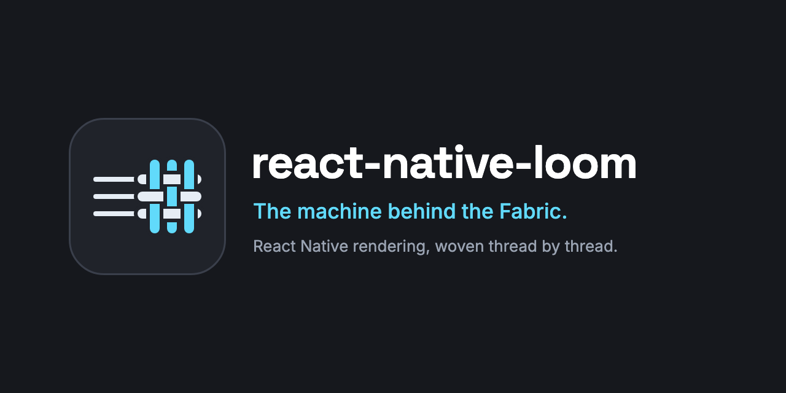

<p align="center"></p>

# react-native-loom

**The machine behind the Fabric.** Loom is a React Native distribution with its
own renderer: React's output is woven straight into native views, with
JavaScript on the main thread like a native app (instant updates, synchronous
native lists) or on its own thread, and compile-time switches to choose.

It is maintained **out of tree**: a package that layers explicit, hash-tracked,
3-way-mergeable overrides on top of the **unmodified `react-native` from npm**,
instead of a fork of `facebook/react-native`.

Taking an upstream fix is then a version bump plus `loom upgrade`, not a fork
rebase.

## How it works

`packages/react-native-loom/overrides.json` lists every file Loom touches:

| type | meaning |
|---|---|
| `patch` | a full copy of an upstream file with Loom edits, derived from the pristine npm file whose sha256 is recorded as `baseHash` |
| `platform` | a Loom-only file that does not exist upstream |
| `delete` | an upstream file Loom removes (none today) |
| `test` | an Android unit test that npm does not ship; kept for CI, never materialized |

`loom materialize` compiles those into `node_modules/.loom/react-native`: a
copy of the pristine `node_modules/react-native` with the overrides applied,
plus a `.loom-stamp.json` that makes the step a no-op while it is current.
`node_modules/react-native` is never modified — it stays the 3-way merge base
and the tree `loom validate` hashes against.

Materialize refuses to run when validation fails: the installed RN version is
not the one the overrides target, an upstream file no longer matches its
`baseHash`, a `platform` file now also exists upstream, or `src/` has untracked
files.

## Requirements

- Node.js >= 20
- The app's `react-native` must be exactly the version the overrides target
  (`overrides.json > upstream.version`), which is also the package's pinned
  `peerDependency`.

## Install

```sh
yarn add react-native-loom
# or
npm install react-native-loom
```

RN can no longer come from prebuilt binaries on either platform: the overrides
patch React-Core and ReactAndroid sources, so RN always builds from source. That
is already true for the fork today.

## App integration

### Android

`android/settings.gradle`:

```groovy
apply from: file("../node_modules/react-native-loom/integration/android/loom.settings.gradle")
```

`android/settings.gradle.kts`:

```kotlin
apply(from = file("../node_modules/react-native-loom/integration/android/loom.settings.gradle"))
```

That runs `loom materialize`, includes the materialized tree as a composite
build, and substitutes `react-android` / `react-native` →
`:packages:react-native:ReactAndroid` and `hermes-android` / `hermes-engine` →
`:packages:react-native:ReactAndroid:hermes-engine`.

`android/app/build.gradle` — point the RN Gradle plugin's codegen at the same tree:

```groovy
react {
  reactNativeDir = file("../node_modules/.loom/react-native")
}
```

### iOS

`ios/Podfile`, replacing the usual `require Pod::Executable.execute_command(...)`
line:

```ruby
require_relative '../node_modules/react-native-loom/integration/ios/loom_pods'
require File.join(Loom.react_native_path(__dir__), 'scripts/react_native_pods')

# ...
use_react_native!(
  :path => Loom.react_native_path(__dir__),
  # ...existing options...
)
```

`Loom.react_native_path(__dir__)` materializes the tree and returns its path.
It also forces `RCT_USE_PREBUILT_RNCORE=0`, because prebuilt RN core binaries
cannot contain the overrides.

### Autolinking / React Native CLI

`react-native.config.js`:

```js
module.exports = {
  reactNativePath: './node_modules/.loom/react-native',
  // ...project/dependencies as usual...
};
```

### Metro

```js
const {getDefaultConfig, mergeConfig} = require('@react-native/metro-config');
const {withLoom} = require('react-native-loom/integration/metro');

module.exports = withLoom(
  mergeConfig(getDefaultConfig(__dirname), {
    // ...your config...
  }),
  __dirname,
);
```

`withLoom` materializes if needed and maps `react-native` and `react-native/*`
to the materialized tree, so JS overrides such as `LayoutAnimation.js` are what
gets bundled.

### Jest

```js
const {loomJestModuleNameMapper} = require('react-native-loom/integration/metro');

module.exports = {
  preset: 'react-native',
  moduleNameMapper: loomJestModuleNameMapper(__dirname),
};
```

## Compile-time switches

Android (`android/gradle.properties`; `loom materialize` copies these into the
materialized tree, because an included Gradle build cannot see the app's
`gradle.properties`, and `-P<name>=<value>` on the command line still wins).
With none set, the build is stock React Native:

| switch | values | effect |
|---|---|---|
| `loom.renderer` | `fabric` (default) \| `loom` | which renderer draws the app |
| `loom.js` | `background` (default) \| `main` | JavaScript on its own thread, or on the Android main thread like a native app |
| `loom.worker` | `true` \| `false` (default) | Loom commit preparation (layout, text, diff) on a worker thread; requires `loom.renderer=loom`, and is required with `loom.js=background` |
| `loom.profile` | `true` \| `false` (default) | diagnostic C++ and mount timers |
| `loom.cppTests` | `true` \| `false` (default) | builds the C++ Loom renderer tests |

The usual configurations:

```properties
# JavaScript on the main thread: instant updates, synchronous native lists
loom.renderer=loom
loom.js=main
loom.worker=true

# JavaScript on its own thread: busy JavaScript never blocks frames
loom.renderer=loom
loom.js=background
loom.worker=true
```

Debug builds also report main-thread blocks longer than 50 ms, with the cause
and sampled stacks, in the JS console (`adb shell setprop
debug.loom.jank_budget_ms N` to change the budget, `debug.loom.jank 0` to turn
it off).

iOS (environment variables; `loom.js=main` is Android-only):

| variable | effect |
|---|---|
| `RCT_LOOM_RENDERER_IOS=1` | selects the Loom renderer |
| `RCT_LOOM_WORKER_IOS=1` | worker-owned commit preparation (requires the above) |

## CLI

App commands (run from the app root):

```
loom materialize [--force] [--out <dir>]   build node_modules/.loom/react-native
loom validate                              check overrides against installed react-native
```

Maintainer commands (run in this repo):

```
loom status                                overrides by area, lines carried
loom diff [path-substring...]              unified diff of patches vs upstream
loom add <rn-relative-path> [--area a]     start overriding an upstream file
loom add --platform <rn-relative-path>     register a new Loom-only file
loom upgrade --to <version>                3-way merge overrides onto a new RN
loom overlay --monorepo <dir>              write overrides (+ Android tests, rn-tester
                                            benchmarks) into a react-native checkout
loom import-fork --fork <dir> --base <sha> capture a checkout's working tree back into
                                            overrides (inverse of overlay)
```

`--upstream <dir>` uses that react-native package instead of fetching one from npm.

`loom status` is the headline metric for shrinking the patch surface.

## Repository layout

```
package.json                     workspace root (workspaces: packages/*)
packages/react-native-loom/     the published package
  overrides.json                 upstream {package, version} + one entry per file
  src/                           full-file overrides, mirroring react-native package paths
  android-tests/                 ReactAndroid/src/test/** (npm does not ship these)
  bin/loom.js                   CLI
  lib/                           manifest, materialize, validate, upgrade, import-fork,
                                 overlay, status/diff
  integration/                   android/loom.settings.gradle, ios/loom_pods.rb, metro.js
apps/loom-test-app/             RN 0.89 test app wired through the integrations, plus
                                 the benchmark harness (bench/)
examples/rn-tester/              benchmark screens + NativeTextBenchmarkActivity patch
brand/                           logo, lockups, social preview (generate.py)
.local/                          git-ignored scratch: notes, benchmark output
```

`apps/loom-test-app` is deliberately **not** a workspace member: it keeps its own
`node_modules`, which is what `loom materialize` and the integration helpers
assume. Install it from its own directory (see its README).

## Developing against a react-native checkout

```sh
node packages/react-native-loom/bin/loom.js overlay --monorepo ~/Work/react-native
# ...hack in rn-tester...
node packages/react-native-loom/bin/loom.js import-fork --fork ~/Work/react-native --base v0.89.0-rc.0
node packages/react-native-loom/bin/loom.js validate
```

`overlay` → `import-fork` is a lossless round trip on a clean checkout at the
upstream tag.

## License

MIT. Files under `packages/react-native-loom/src/` are derived from
react-native (MIT, Meta Platforms, Inc. and affiliates); see
[LICENSE](LICENSE).