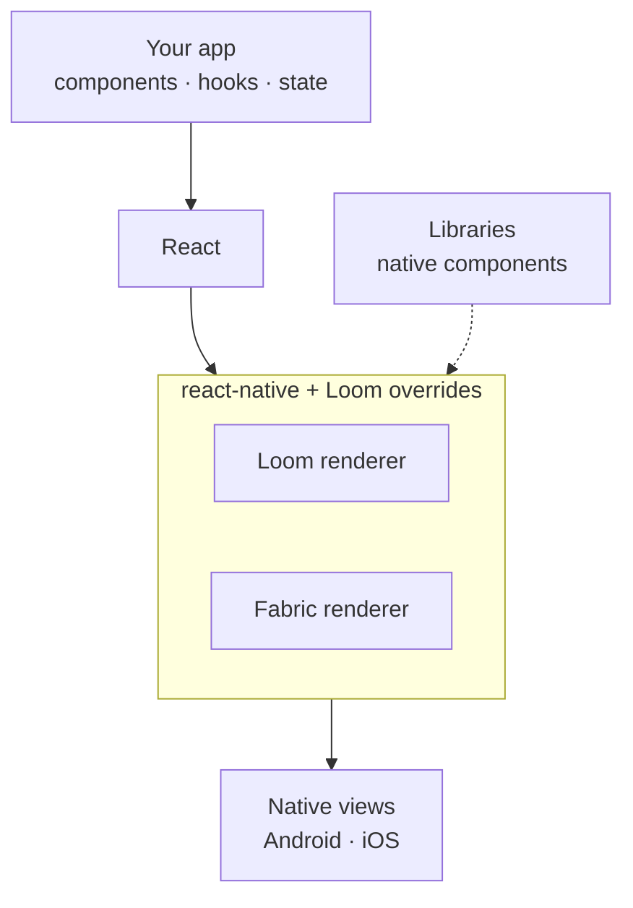
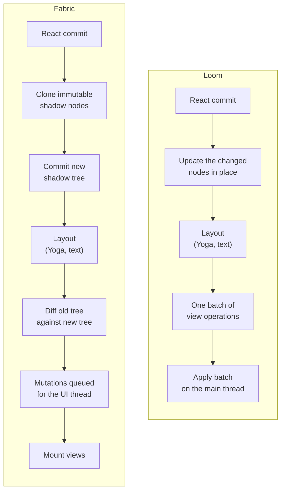
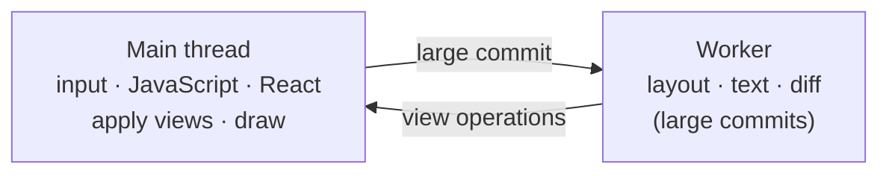
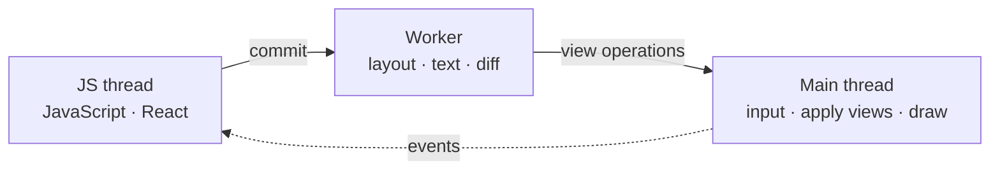
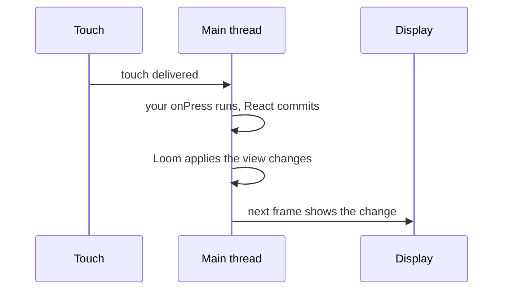
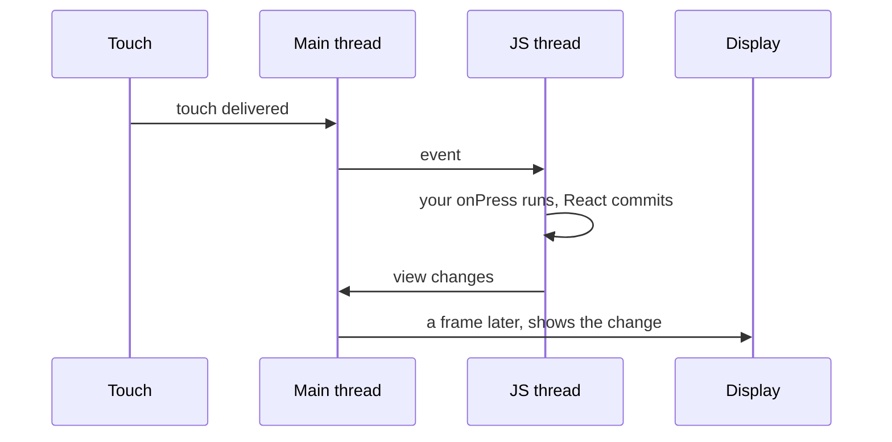

# What is Loom?

**Loom** is a renderer for React Native. It replaces **Fabric**, React Native's own renderer,
and comes with a threading model of its own. Your app keeps its React code, its components and
its libraries; Loom changes how React's output becomes native views, and on which thread your
JavaScript runs.

Loom is not a fork. It is a package of overrides applied to the unmodified `react-native` from
npm, so it tracks React Native releases closely.

## Where Loom sits

A build switch chooses the renderer. With Loom switched off, the build is stock React Native.

## How a frame is woven

Both renderers start from the same thing: React calling the renderer's host functions
(`createNode`, `cloneNode…`, `appendChild`, `completeRoot`) as it commits. What happens next
differs.

- **Fabric** keeps an immutable shadow tree. Every commit clones the changed nodes and their
  ancestors, lays out the new tree, then diffs it against the previous one to find out what to
  mount.
- **Loom** keeps one mutable tree. A commit updates only the nodes React changed, lays them out,
  and emits the view operations directly, so there is no clone-and-diff step. A prop or text
  change updates its node in place, without cloning its ancestors, and only the props that
  changed are sent to the platform views, applied in a single call per commit.

## Threads

Loom runs JavaScript where you choose: on the **main thread**, like a native app, or on
its **own thread**, as React Native does by default, on Android and iOS. Layout, text measuring and diffing can run
on a **worker** thread in either mode.

**JavaScript on the main thread** (`loom.js=main`):

**JavaScript on its own thread** (`loom.js=background`):

Small commits skip the worker and run inline, because handing them off would cost more than
the work itself.

## A tap, in each mode

With JavaScript on the main thread, the tap is handled while Android is still processing the
touch, and the change is drawn in the very next frame:

With JavaScript on its own thread, the event crosses to the JS thread and the result crosses
back, so the change usually lands one frame later:

See [Choosing a mode](/guide/modes) for the full trade-off.

## What JavaScript on the main thread makes possible

Native code can call into React and get an answer before it returns. That enables things
React Native normally can't do:

- **Instant updates**: a `setState` in a touch handler is as fast as `setNativeProps`. See
  [Instant updates](/guide/instant-updates).
- **Frame-aligned work**: `requestAnimationFrame` callbacks run before the frame is drawn, and
  non-urgent React work yields to frames. See
  [Large updates and transitions](/guide/transitions).

## What stays the same

| | |
|---|---|
| Your React code | Unchanged |
| Components and APIs from `react-native` | Unchanged |
| Libraries built on view managers and generated components | Work as they are |
| Libraries using Fabric's C++ internals | Work unchanged through Loom's compatibility layer; see [Supported libraries](/guide/compatibility) |
| Hermes | Unchanged |

## Glossary

| Term | Meaning |
|---|---|
| **Loom renderer** | Loom's replacement for Fabric's renderer: a mutable node tree, layout, and one batch of view operations per commit |
| **Worker** | A background thread that runs layout, text measuring and diffing for large commits |
| **Inline commit** | A small commit processed on the current thread instead of the worker |
| **Main-thread mode** | `loom.js=main`: JavaScript runs on Android's main thread |
| **Background mode** | `loom.js=background`: JavaScript runs on its own thread |
| **Overrides** | The files Loom adds to or changes in `react-native`, listed in `overrides.json` |
| **Materialized tree** | `node_modules/.loom/react-native`: the installed `react-native` with the overrides applied |

## Platforms

| | Android | iOS |
|---|---|---|
| Loom renderer | Yes | Yes |
| Worker | Yes | Yes |
| JavaScript on the main thread | Yes (`loom.js=main`) | Yes (`RCT_LOOM_JS_IOS=main`) |
| JavaScript on its own thread with the Loom renderer | Yes (`loom.js=background`) | Yes (`RCT_LOOM_JS_IOS=background`) |
| Text drawn off the main thread | No | Yes ([asynchronous text](/guide/async-text)) |
| Startup baseline profile | Yes | Not applicable |
| Debug jank reporter | Yes | No |
